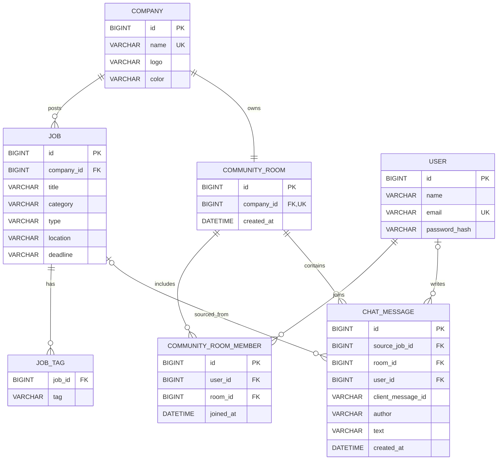

# 기업 커뮤니티 기술 설계

## 1. 문서 정보

- 상태: 승인됨
- 승인일: 2026-11-02
- 작성일: 2026-10-29
- 변경일: 2026-11-03
- 기준 요구사항: [community-requirements.md](./community-requirements.md)
- 참고 기록: [community-technical-decisions.md](./community-technical-decisions.md)
- 범위: 회사 관계 정규화, 기업별 채팅방 참여, 목록, 메시지 조회·송수신, 나가기, 기존 메시지 마이그레이션

이 문서는 승인된 요구사항을 현재 코드베이스에 적용하기 위한 기술 설계다. 구현 순서와 작업 분할은 설계 승인 후 별도로 작성한다.

## 2. 현재 시스템 분석

### 2.1 실제 코드에서 확인한 사실

#### 백엔드

- Java 17, Spring Boot 3.5.7, Spring MVC, JPA를 사용한다.
- Controller → Service → Repository → Entity의 계층 구조를 사용한다.
- MySQL 8.4와 Flyway가 영속 데이터와 스키마 이력을 관리한다.
- `users`, `companies`, `jobs`, `job_tags`, `community_rooms`, `community_room_members`, `chat_messages` 테이블이 존재한다.
- 회사는 독립 `Company` 엔티티이며 공고와 기업 채팅방이 `company_id`로 참조한다.
- `chat_messages.room_id`가 메시지를 기업 방별로 구분하고 nullable `source_job_id`가 기존 출처 공고를 보존한다.
- 메시지에는 nullable `user_id`, 작성 당시 이름인 `author`, 최대 120자의 `text`, UTC `created_at`이 저장된다.
- 메시지 조회 API는 로그인과 방 참여 권한을 확인하고 최신 50개를 오래된 순서로 반환한다.
- 메시지 전송 API와 WebSocket은 아직 구현되지 않았다.
- 로그인은 Spring Security 필터 없이 `AuthService`가 Bearer opaque token을 직접 검증한다.
- 로그인 세션은 Redis의 `auth:session:{token}` 키에 24시간 고정 TTL로 저장된다.
- WebSocket, Redis Pub/Sub, 공통 오류 응답은 구현되어 있지 않다.

#### 프론트엔드

- React 19와 브라우저 Fetch API를 사용한다.
- 화면과 인증 상태는 `App`의 `useState`로 관리하며 React Router와 전역 상태 라이브러리는 없다.
- 로그인 토큰은 `localStorage`에 저장한다.
- 독립 `CommunityPage`가 참여 방 목록, 선택 방 메시지와 나가기를 제공한다.
- 공고 상세와 상단 커뮤니티 메뉴는 로그인 후 참여·이동 의도를 복원한다.
- 공고 API 장애에는 샘플 데이터를 사용하지만 커뮤니티 API 장애에는 가짜 방이나 메시지를 표시하지 않는다.
- 프론트엔드에는 검색·필터와 커뮤니티 API에 대한 `node:test`가 있다.

### 2.2 문서에만 있고 아직 구현되지 않은 내용

- 참여자 전용 메시지 전송과 실시간 수신
- WebSocket JSON 프로토콜과 연결 인증
- Redis Pub/Sub 서버 간 중계
- 재연결 후 REST 재조회 복구
- 모바일 목록·채팅 전환과 연결 상태 UI 마무리

### 2.3 영향 범위

| 영역 | 영향 |
| --- | --- |
| DB | 회사, 기업 채팅방, 참여 관계, 공고-회사 관계, 회사-방 관계, 메시지-방 관계, 인덱스와 기존 데이터 이관 |
| 백엔드 도메인 | `Company`, `Job`, `ChatMessageEntity`, 채팅방·참여 엔티티와 Repository |
| 백엔드 API | 기존 공고 메시지 API 제거, 참여·목록·조회 REST API 추가 |
| 실시간 처리 | WebSocket 인증·송신·수신, Redis 발행·구독, 연결 수명 관리 |
| 인증·인가 | REST와 WebSocket 세션 확인, 참여 여부 확인, 나가기 직후 수신 차단 |
| 프론트엔드 | 독립 커뮤니티 페이지, 로그인 후 의도 복원, WebSocket 연결과 재연결 |
| 테스트 | 서비스 단위 테스트, MySQL 마이그레이션 검증, Redis·WebSocket 통합 검증, 반응형 사용자 흐름 검증 |
| 문서 | `BACKEND.md`, `FRONTEND.md`, OpenAPI 설명의 공고별 채팅 내용을 기업별 커뮤니티로 변경 |

현재 `frontend/src/app/App.jsx`에는 커뮤니티 작업과 무관한 사용자 포맷 변경이 있다. 구현 시 이를 되돌리거나 덮어쓰지 않는다.

## 3. 설계 원칙과 확정 결정

### 3.1 회사와 기업 채팅방을 별도 식별한다

`companies`에 안정적인 회사 ID를 부여하고 모든 `jobs`가 `company_id`를 참조한다. `community_rooms`도 독립 ID를 유지하고 `company_id`의 유일 제약으로 회사당 방 하나를 보장한다. 회사명은 최초 이관과 표시를 위한 값이며 공고·방 관계의 키로 사용하지 않는다.

검토한 대안:

- `company_id`와 `room_id`를 같은 값으로 사용: 서로 다른 엔티티의 의미와 수명을 결합한다.
- `jobs.community_room_id` 유지: `job → company → room`으로 결정되는 관계를 중복 저장해 불일치 가능성이 생긴다.
- 기업명 문자열을 직접 관계 키로 사용: 이름 변경과 표기 차이에 취약하다.

### 3.2 기본 WebSocket과 JSON 프로토콜을 사용한다

STOMP 없이 Spring WebSocket과 브라우저 기본 `WebSocket` API를 사용한다. 연결 후 첫 JSON 프레임으로 인증하며 토큰을 URL에 포함하지 않는다.

검토한 대안:

- STOMP: 목적지와 구독 모델은 편리하지만 서버·클라이언트 의존성과 프로토콜 계층이 추가된다.
- URL 쿼리 토큰: 구현은 작지만 프록시와 접근 로그에 장기 세션 토큰이 남을 수 있다.

### 3.3 MySQL을 원본으로, Redis Pub/Sub을 실시간 중계로 사용한다

메시지는 MySQL 트랜잭션이 커밋된 뒤 Redis에 발행한다. Redis에는 원본 메시지나 전달 이력을 저장하지 않는다.

Redis 발행이 실패하면 저장된 메시지를 되돌리지 않는다. 송신자에게 `STORED_BUT_NOT_BROADCAST`를 반환하고 UI는 저장 완료와 실시간 전달 지연을 구분해서 알린다. 재연결 또는 즉시 REST 재조회로 저장된 메시지를 복구한다.

검토한 대안:

- Redis Streams: MySQL 원본과 최신 50개 복구가 있는 현재 범위에는 소비 이력 관리가 중복된다.
- Transactional Outbox: 최종 발행 보장은 강화되지만 별도 테이블, 재시도 작업과 중복 처리가 필요해 현재 요구사항보다 크다.

### 3.4 참여 관계 행으로 전송과 나가기를 직렬화한다

메시지 저장과 나가기는 동일한 참여 관계 행에 비관적 쓰기 잠금을 사용한다. 먼저 시작한 작업이 완료된 뒤 다음 작업이 진행되므로 나가기 응답이 완료된 이후 새 메시지가 저장되지 않는다.

Redis 분산 잠금은 사용하지 않는다. 권한의 원본과 메시지 트랜잭션이 모두 MySQL에 있으므로 DB 행 잠금이 더 작고 정확하다.

### 3.5 WebSocket 연결은 로그인 TTL을 넘기지 않는다

인증할 때 Redis 세션의 남은 TTL을 읽고 해당 시각에 연결을 닫는 타이머를 설정한다. 메시지 전송 시에는 세션과 참여 관계를 다시 검증한다.

현재 서버 로그아웃이나 세션 강제 폐기 기능은 없으므로 주기적인 Redis 조회는 추가하지 않는다. 해당 기능이 생기면 세션 폐기 이벤트 또는 주기 검증을 추가한다.

### 3.6 기존 작성자는 참여자로 이관한다

기존 메시지에 `user_id`가 있으면 해당 사용자를 메시지가 병합되는 기업 채팅방의 참여자로 등록한다. `user_id IS NULL`인 초기·익명 메시지는 참여 관계를 만들지 않는다.

## 4. 시스템 구성과 책임

```text
React CommunityPage
  ├─ REST: 참여, 방 목록, 최신 메시지 50개, 나가기
  └─ WebSocket: 인증, 메시지 전송, 참여 중인 방의 새 메시지 수신
          │
Spring MVC / WebSocket
  ├─ AuthService: opaque token과 Redis TTL 검증
  ├─ CommunityService: 참여, 목록, 조회, 나가기
  ├─ CommunityMessageService: 참여 잠금과 메시지 저장
  └─ CommunityRealtimeService: 커밋 후 Redis 발행과 로컬 연결 전달
          │
          ├─ MySQL: 회사, 공고, 방, 참여 관계, 메시지 원본
          └─ Redis: 로그인 세션, 서버 간 실시간 이벤트
```

### 4.1 백엔드 컴포넌트

- `CommunityController`
  - 참여, 참여 방 목록, 최신 메시지 조회, 나가기 REST 계약을 담당한다.
- `CommunityService`
  - 공고에서 방 찾기, 멱등 참여, 참여 방 목록, 참여자 전용 조회와 나가기를 담당한다.
- `CommunityMessageService`
  - 참여 관계를 잠그고 메시지를 저장하는 트랜잭션을 담당한다.
  - 트랜잭션 메서드 반환 시 커밋이 완료되도록 실시간 발행 책임과 분리한다.
- `CommunityWebSocketHandler`
  - 첫 프레임 인증, JSON 타입 분기, 입력 검증, 오류·결과 프레임 전송을 담당한다.
- `CommunityRealtimeService`
  - 저장 완료 뒤 Redis 발행을 호출하고 발행 결과를 WebSocket 응답 상태로 변환한다.
- `CommunityRedisSubscriber`
  - Redis 이벤트를 받아 현재 인스턴스에 연결된 사용자 중 DB상 참여 중인 사용자에게만 전달한다.
- `CommunityConnectionRegistry`
  - 현재 인스턴스의 WebSocket 연결과 인증 사용자만 메모리에 보관한다.
  - 원본 메시지나 참여 권한을 캐시하지 않는다.

새 컴포넌트는 기존의 계층형 패키지인 `controller`, `service`, `repository`, `entity`, `dto`, `config` 안에 둔다. 기능별 최상위 패키지는 추가하지 않는다.

### 4.2 프론트엔드 컴포넌트

- `App`
  - 현재 화면, 로그인 상태와 로그인 후 실행할 이동 의도를 관리한다.
- `CommunityPage`
  - 방 목록, 선택한 방, 메시지, 연결·오류 상태를 조립한다.
- 커뮤니티 목록 UI
  - 참여한 방만 표시하고 `lastMessageAt` 최근 순으로 유지한다.
- 커뮤니티 채팅 UI
  - 선택한 방의 최신 50개, 송신 상태, 재연결 상태와 나가기를 표시한다.
- `careerpickApi.js`
  - 참여, 목록, 메시지 조회와 나가기 HTTP 요청을 추가한다.
- 커뮤니티 WebSocket 모듈
  - 연결, 첫 인증 프레임, 재연결, 메시지 ID 기반 중복 제거를 담당한다.

별도 전역 상태 라이브러리와 React Router는 추가하지 않는다. 요구사항에 URL 직접 진입이나 브라우저 뒤로 가기 계약이 없으므로 기존 문자열 화면 상태를 확장한다.

## 5. 데이터 모델

이 절은 V5 적용 후 현재 전체 스키마를 나타낸다. V1~V4에서 사용한 `jobs.company`, `logo`, `color`, `community_room_id`와 `community_rooms.company_name`의 전환 절차는 13장에서 설명한다.

### 5.1 전체 ERD



- `Company`와 `CommunityRoom`은 각각 독립된 ID를 가진다.
- `community_rooms.company_id`의 UNIQUE 제약으로 회사당 방 하나를 보장한다.
- `community_room_members`는 `(user_id, room_id)` 복합 UNIQUE 제약을 가진다.
- `chat_messages.source_job_id`, `user_id`, `client_message_id`는 nullable이다.
- Redis 로그인 세션은 MySQL 엔티티가 아니므로 ERD에 포함하지 않는다.

### 5.2 `companies`

| 컬럼 | 타입 | 제약 | 설명 |
| --- | --- | --- | --- |
| `id` | BIGINT | PK, AUTO_INCREMENT | 안정적인 회사 ID |
| `name` | VARCHAR(100) | NOT NULL, UNIQUE | 회사 표시명 |
| `logo` | VARCHAR(10) | NOT NULL | 현재 UI에서 사용하는 회사 표시 문자 |
| `color` | VARCHAR(20) | NOT NULL | 현재 UI에서 사용하는 회사 표시 색상 |

`name`은 현재 MVP에서 회사 중복 등록을 막기 위해 정확 일치 유일 제약을 사용한다. 회사 생성 후 공고와 방의 관계는 이름이 아니라 `company_id`로 유지한다. 사업자등록번호와 회사 관리 API는 현재 범위에 포함하지 않는다.

### 5.3 `users`

| 컬럼 | 타입 | 제약 | 설명 |
| --- | --- | --- | --- |
| `id` | BIGINT | PK, AUTO_INCREMENT | 사용자 ID |
| `name` | VARCHAR(50) | NOT NULL | 사용자 표시명 |
| `email` | VARCHAR(255) | NOT NULL, UNIQUE | 로그인 이메일 |
| `password_hash` | VARCHAR(60) | NOT NULL | BCrypt 비밀번호 해시 |

### 5.4 `jobs`

| 컬럼 | 타입 | 제약 | 설명 |
| --- | --- | --- | --- |
| `id` | BIGINT | PK, AUTO_INCREMENT | 공고 ID |
| `company_id` | BIGINT | NOT NULL, FK | 공고를 게시한 회사 |
| `title` | VARCHAR(200) | NOT NULL | 공고 제목 |
| `category` | VARCHAR(30) | NOT NULL, INDEX | 직무 분야 |
| `type` | VARCHAR(30) | NOT NULL | 고용·경력 유형 |
| `location` | VARCHAR(100) | NOT NULL | 근무 지역 |
| `deadline` | VARCHAR(30) | NOT NULL | 현재 MVP 마감일 표시 문자열 |

기존 `company`, `logo`, `color`, `community_room_id`는 회사와 방 관계를 중복 저장하므로 이관 완료 후 제거한다. 공고 응답은 연결된 회사의 `companyId`·이름·로고·색상을 사용한다. 기존 필드는 유지하고 `companyId`를 추가해 기존 클라이언트와 호환된다.

### 5.5 `job_tags`

| 컬럼 | 타입 | 제약 | 설명 |
| --- | --- | --- | --- |
| `job_id` | BIGINT | NOT NULL, FK, INDEX | 태그가 속한 공고 |
| `tag` | VARCHAR(50) | NOT NULL | 공고 검색 보조 태그 |

공고가 삭제되면 연결된 태그도 함께 삭제한다.

### 5.6 `community_rooms`

| 컬럼 | 타입 | 제약 | 설명 |
| --- | --- | --- | --- |
| `id` | BIGINT | PK, AUTO_INCREMENT | 안정적인 채팅방 ID |
| `company_id` | BIGINT | NOT NULL, FK, UNIQUE | 방을 소유한 회사 |
| `created_at` | DATETIME(6) | NOT NULL | 방 생성 시각, UTC |

회사당 방 하나를 DB 제약으로 보장한다. 회사명 변경은 회사 행만 변경하며 방 ID, 참여 관계와 메시지는 바꾸지 않는다.

### 5.7 `community_room_members`

| 컬럼 | 타입 | 제약 | 설명 |
| --- | --- | --- | --- |
| `id` | BIGINT | PK, AUTO_INCREMENT | 참여 관계 ID |
| `user_id` | BIGINT | NOT NULL, FK | 사용자 |
| `room_id` | BIGINT | NOT NULL, FK | 채팅방 |
| `joined_at` | DATETIME(6) | NOT NULL | 최초 또는 재참여 시각, UTC |

- `(user_id, room_id)`에 유일 제약을 둬 중복 참여를 DB에서 막는다.
- 나가기는 행을 삭제한다.
- 재참여하면 새 행과 새 `joined_at`이 생성된다.
- 나가거나 재참여해도 메시지는 변경하지 않는다.

### 5.8 `chat_messages`

| 컬럼 | 타입 | 제약 | 설명 |
| --- | --- | --- | --- |
| `id` | BIGINT | PK, AUTO_INCREMENT | 메시지 ID |
| `source_job_id` | BIGINT | NULL, FK | 기존 메시지의 출처 공고 보존용 |
| `room_id` | BIGINT | NOT NULL, FK | 메시지가 속한 기업 채팅방 |
| `user_id` | BIGINT | NULL, FK | 인증 작성자, 기존 익명 메시지는 NULL |
| `client_message_id` | VARCHAR(36) | NULL | WebSocket 재전송 중복 방지 |
| `author` | VARCHAR(50) | NOT NULL | 작성 당시 표시명 |
| `text` | VARCHAR(120) | NOT NULL | 메시지 본문 |
| `created_at` | DATETIME(6) | NOT NULL | 작성 시각, UTC |

- `(room_id, created_at DESC, id DESC)` 인덱스로 최신 50개와 최근 활동 조회를 지원한다.
- `(user_id, client_message_id)`에 유일 제약을 둔다. 기존 NULL 값은 여러 건을 허용한다.
- 같은 `client_message_id`가 다시 도착하면 새 메시지를 만들지 않고 기존 저장 결과를 반환한다.
- `source_job_id`는 메시지 범위나 권한 판정에 사용하지 않는다. 데이터 손실 없는 전환과 감사 용도로만 남긴다.

### 5.9 방 목록 정렬

- 메시지가 있는 방은 `lastMessageAt DESC`, 마지막 메시지 ID DESC로 정렬한다.
- 메시지가 없는 방은 메시지가 있는 방 뒤에 배치한다.
- 빈 방끼리는 `joinedAt DESC`, 방 ID DESC로 정렬한다.
- 최근 메시지는 쿼리에서 계산하며 `last_message_at` 중복 컬럼은 두지 않는다.

현재 범위의 데이터 규모에서는 정합성이 우선이다. 방 목록 쿼리가 실제 부하에서 병목으로 확인될 때만 마지막 메시지 요약값의 비정규화를 검토한다.

## 6. REST API 계약

공고·참여·방 목록 응답의 `companyId`는 같은 `companies.id`를 가리킨다. 방 `id`는 `community_rooms.id`로 별개이며, 두 ID의 숫자 일치를 관계로 해석하지 않는다.

### 6.1 공고 목록

```http
GET /api/jobs
```

기존 공고 필드를 유지하고 연결된 회사 ID를 추가한다.

```json
{
  "id": 101,
  "companyId": 3,
  "company": "네오테크",
  "logo": "N",
  "color": "#6556df"
}
```

모든 커뮤니티 API는 `Authorization: Bearer {opaque-token}`을 요구한다.

### 6.2 공고를 통한 참여

```http
PUT /api/jobs/{jobId}/community-membership
```

- 공고의 `company_id`로 회사의 기업 방을 찾아 참여한다.
- 이미 참여 중이면 새 행을 만들지 않고 같은 결과를 반환한다.
- 신규·기존 참여 모두 `200 OK`로 통일해 클라이언트 분기를 줄인다.

응답:

```json
{
  "room": {
    "id": 12,
    "companyId": 3,
    "companyName": "네오테크"
  }
}
```

### 6.3 참여 방 목록

```http
GET /api/community-rooms
```

응답:

```json
[
  {
    "id": 12,
    "companyId": 3,
    "companyName": "네오테크",
    "joinedAt": "2026-10-29T01:00:00Z",
    "lastMessage": {
      "id": 91,
      "author": "김커리",
      "text": "면접 일정 공유됐나요?",
      "createdAt": "2026-10-29T03:15:00Z"
    }
  }
]
```

빈 방의 `lastMessage`는 `null`이다.

### 6.4 최신 메시지 조회

```http
GET /api/community-rooms/{roomId}/messages
```

- 참여자만 조회할 수 있다.
- DB에서는 최신 50개를 역순으로 제한해 조회한 뒤 응답은 오래된 순서로 정렬한다.
- 페이지네이션과 과거 추가 조회는 제공하지 않는다.

응답 메시지:

```json
{
  "id": 91,
  "roomId": 12,
  "author": "김커리",
  "text": "면접 일정 공유됐나요?",
  "createdAt": "2026-10-29T03:15:00Z",
  "mine": true,
  "clientMessageId": "a599e38b-f02f-4aeb-8e9a-f3b638095866"
}
```

`mine`은 인증 사용자와 `user_id`를 비교해 서버가 계산한다. 다른 사용자의 내부 사용자 ID는 노출하지 않는다.

### 6.5 나가기

```http
DELETE /api/community-rooms/{roomId}/membership
```

- 참여 관계 행을 잠근 뒤 삭제한다.
- 이미 나간 상태에도 `204 No Content`를 반환하는 멱등 동작으로 정의한다.
- 메시지와 방은 삭제하지 않는다.
- 프론트엔드는 요청 전에 한 번 확인창을 표시한다.

### 6.6 기존 API 처리

다음 공고별 메시지 API는 제거한다.

- `GET /api/jobs/{jobId}/messages`
- `POST /api/jobs/{jobId}/messages`

현재 저장소 내부 호출자는 새 커뮤니티 API와 WebSocket으로 함께 변경한다. 외부 호환성 요구사항이 없고 기존 조회 API가 참여 권한 없이 메시지를 노출하므로 호환 엔드포인트를 유지하지 않는다.

## 7. WebSocket 계약

### 7.1 연결

```text
ws://localhost:8080/ws/community
```

운영 환경에서는 반드시 `wss`를 사용한다. 서버는 허용된 프론트엔드 Origin만 수락한다.

연결 후 5초 안에 첫 프레임으로 인증하지 않으면 연결을 닫는다.

클라이언트 → 서버:

```json
{
  "type": "AUTH",
  "token": "opaque-token"
}
```

서버 → 클라이언트:

```json
{
  "type": "AUTHENTICATED",
  "expiresAt": "2026-10-30T03:20:00Z"
}
```

- 인증 실패: 오류 프레임 후 정책 위반 코드로 종료한다.
- Redis 세션 저장소에 연결할 수 없음: 일시 장애 오류 후 재시도 가능한 코드로 종료한다.
- 인증 성공 뒤 서버는 토큰 TTL 시각에 연결을 종료한다.

### 7.2 구독 모델

별도의 `SUBSCRIBE` 프레임을 두지 않는다. 인증된 연결은 해당 사용자가 참여 중인 모든 방의 새 메시지 이벤트를 받을 수 있다.

이 방식은 다음을 만족한다.

- 선택하지 않은 방에 새 메시지가 와도 목록의 미리보기와 순서를 갱신할 수 있다.
- 방 선택과 WebSocket 구독 상태를 이중으로 관리하지 않는다.
- 서버가 전달 직전 DB 참여 관계를 기준으로 수신 권한을 다시 확인한다.

### 7.3 메시지 전송

클라이언트 → 서버:

```json
{
  "type": "SEND_MESSAGE",
  "clientMessageId": "a599e38b-f02f-4aeb-8e9a-f3b638095866",
  "roomId": 12,
  "text": "면접 일정 공유됐나요?"
}
```

- `clientMessageId`는 클라이언트가 생성한 UUID다.
- `text`는 trim 후 1~120자여야 한다.
- 서버는 클라이언트가 보낸 사용자 ID나 작성자명을 받지 않는다.

정상 발행 결과:

```json
{
  "type": "SEND_RESULT",
  "clientMessageId": "a599e38b-f02f-4aeb-8e9a-f3b638095866",
  "status": "PUBLISHED",
  "message": {}
}
```

DB 저장 후 Redis 발행 실패 결과:

```json
{
  "type": "SEND_RESULT",
  "clientMessageId": "a599e38b-f02f-4aeb-8e9a-f3b638095866",
  "status": "STORED_BUT_NOT_BROADCAST",
  "message": {}
}
```

DB 저장 실패, 세션 만료, 미참여와 입력 오류는 `ERROR` 프레임으로 반환한다. DB 저장 실패에는 `message`를 반환하지 않는다.

### 7.4 새 메시지 이벤트

Redis 이벤트를 받은 각 서버는 현재 인스턴스의 연결 사용자 ID들을 한 번의 DB 조회로 필터링한다. 해당 방에 현재 참여 중인 연결에만 다음 이벤트를 전송한다.

```json
{
  "type": "MESSAGE_CREATED",
  "message": {}
}
```

각 연결에 보낼 때 `mine`을 연결 사용자 기준으로 계산한다. 프론트엔드는 서버 메시지 ID로 REST 결과, 송신 결과와 실시간 이벤트를 중복 제거한다.

## 8. Redis Pub/Sub 설계

- 채널: `careerpick:community:events`
- 이벤트 버전: `schemaVersion: 1`
- 이벤트 타입: `MESSAGE_CREATED`
- 주요 필드: 메시지 ID, 방 ID, 작성 사용자 ID, 작성자 표시명, 본문, 생성 시각, client message ID

모든 서버가 하나의 채널을 구독하고 로컬 연결이 있는 사용자에게만 전달한다. 방별 동적 Redis 구독은 관리 복잡도에 비해 이점이 작아 사용하지 않는다.

Redis 이벤트는 메시지 원본이 아니다. 이벤트 역직렬화 실패는 민감정보 없이 이벤트 타입과 메시지 ID를 로그에 남기고 버린다. 클라이언트는 재연결 시 REST 최신 50개 조회로 복구한다.

## 9. 주요 처리 흐름

### 9.1 공고에서 참여

1. 비로그인 사용자가 커뮤니티 버튼을 누르면 공고 ID를 로그인 후 이동 의도로 저장한다.
2. 로그인 성공 후 `PUT /api/jobs/{jobId}/community-membership`을 호출한다.
3. 서버가 공고와 연결된 방을 찾고 `INSERT ... ON DUPLICATE KEY UPDATE`와 유일 제약으로 참여 관계를 멱등 생성한다.
4. 응답의 방 ID로 커뮤니티 페이지를 열고 해당 방을 선택한다.
5. 목록과 최신 메시지 50개를 조회하고 WebSocket을 연결한다.

상단 커뮤니티 탭에서 로그인한 경우에는 참여를 생성하지 않고 커뮤니티 페이지로만 이동한다. 요구사항대로 방을 자동 선택하지 않는다.

### 9.2 메시지 전송

1. WebSocket handler가 세션을 다시 확인한다.
2. 참여 관계를 비관적 쓰기 잠금으로 조회한다.
3. 같은 `(user_id, client_message_id)`가 있으면 기존 메시지를 반환한다.
4. 인증 사용자 이름으로 메시지를 저장하고 트랜잭션을 커밋한다.
5. 커밋된 메시지를 Redis에 동기 발행한다.
6. 발행 성공 시 `PUBLISHED`, 실패 시 `STORED_BUT_NOT_BROADCAST`를 송신자에게 반환한다.
7. 각 서버가 Redis 이벤트를 받고 현재 참여자만 필터링해 전송한다.

DB 저장 메서드와 Redis 발행 호출자를 다른 Spring bean으로 분리한다. `@Transactional` 메서드가 반환된 뒤에만 발행하므로 별도의 Spring 트랜잭션 이벤트나 Outbox가 필요하지 않다.

### 9.3 나가기와 동시 전송

1. 나가기와 전송 모두 참여 행에 쓰기 잠금을 요청한다.
2. 먼저 잠근 트랜잭션이 완료될 때까지 다른 작업이 기다린다.
3. 전송이 먼저면 메시지 커밋 후 나가기가 완료된다.
4. 나가기가 먼저면 이후 전송은 참여 행을 찾지 못해 거부된다.
5. Redis 메시지를 전달할 때도 현재 참여 여부를 다시 확인해 다른 탭이나 다른 서버 연결로의 수신을 막는다.

### 9.4 재연결

1. 연결 종료 시 1초부터 최대 30초까지 지수 백오프와 작은 무작위 지연으로 재연결한다.
2. 세션 만료 오류에는 자동 재연결하지 않고 로그인 화면을 표시한다.
3. 재인증 성공 후 방 목록을 다시 조회한다.
4. 선택 중인 방에 여전히 참여 중이면 최신 50개를 다시 조회해 화면 메시지를 서버 응답으로 맞춘다.
5. 이미 나간 방이면 선택을 해제하고 목록 화면을 표시한다.

## 10. 인증과 인가

| 동작 | 인증 | 추가 인가 |
| --- | --- | --- |
| 공고 조회 | 불필요 | 없음 |
| 공고를 통한 참여 | 필요 | 유효한 공고 |
| 참여 방 목록 | 필요 | 사용자 본인의 관계만 조회 |
| 메시지 조회 | 필요 | 현재 참여자 |
| 메시지 전송 | 필요 | 잠긴 현재 참여 관계 |
| 실시간 수신 | 필요 | 이벤트 전달 시 현재 참여 관계 |
| 나가기 | 필요 | 본인 참여 관계만 삭제 |

- 토큰, Redis 세션 키와 비밀번호는 로그에 남기지 않는다.
- WebSocket 토큰은 URL, Redis Pub/Sub 이벤트와 클라이언트 응답에 포함하지 않는다.
- 작성자와 사용자 ID는 인증 세션에서 결정한다.
- Origin 제한은 인증을 대체하지 않지만 브라우저의 교차 출처 WebSocket 연결을 줄인다.
- Redis 장애로 인증 상태를 확인할 수 없으면 허용하지 않고 일시 장애로 처리한다.

## 11. 트랜잭션과 동시성

### 참여

- `(user_id, room_id)` 유일 제약이 최종 중복 방지 수단이다.
- MySQL `INSERT ... ON DUPLICATE KEY UPDATE`를 사용해 동시에 같은 참여 요청이 와도 한 행만 생성한다.
- `INSERT IGNORE`는 참여 중복 외의 데이터 오류까지 경고로 낮출 수 있어 사용하지 않는다.

### 전송

- 세션 검증 후 MySQL 트랜잭션에서 참여 행을 쓰기 잠금한다.
- client message ID 중복 조회와 메시지 저장을 같은 트랜잭션에서 수행한다.
- 메시지 커밋 뒤에만 Redis를 호출한다.

### 나가기

- 참여 행을 쓰기 잠금하고 삭제한다.
- 메시지와 방은 수정하지 않는다.

### 목록

- 목록의 마지막 메시지는 `chat_messages`에서 계산한다.
- 동일 시각은 메시지 ID로, 빈 방은 참여 시각과 방 ID로 결정적 정렬한다.

## 12. 예외 처리와 장애 복구

### 12.1 공통 오류 계약

REST 오류는 다음 형식으로 통일한다.

```json
{
  "code": "NOT_A_MEMBER",
  "message": "참여 중인 채팅방이 아닙니다."
}
```

주요 매핑:

| 상황 | HTTP / WebSocket code |
| --- | --- |
| 로그인 없음·만료 | 401 / `AUTH_REQUIRED`, `SESSION_EXPIRED` |
| 미참여 조회·전송 | 403 / `NOT_A_MEMBER` |
| 공고·방 없음 | 404 / `JOB_NOT_FOUND`, `ROOM_NOT_FOUND` |
| 입력 검증 실패 | 400 / `VALIDATION_FAILED` |
| Redis 등 일시 장애 | 503 / `SERVICE_UNAVAILABLE` |
| DB 저장 실패 | 500 / `MESSAGE_STORE_FAILED` |

내부 예외 메시지나 Redis·DB 주소는 응답에 포함하지 않는다.

### 12.2 장애별 동작

- DB 저장 실패
  - Redis 발행과 WebSocket 메시지 이벤트를 수행하지 않는다.
  - 프론트엔드는 입력 내용을 유지한다.
- Redis 발행 실패
  - 저장 메시지를 반환하며 실시간 전달 지연 상태를 표시한다.
  - 프론트엔드는 REST로 최신 메시지를 재조회한다.
- Redis 구독 일시 중단
  - 구독 오류를 감지한 서버는 연결된 클라이언트에 `REALTIME_UNAVAILABLE`을 알리고 소켓을 닫는다.
  - 프론트엔드는 연결 상태를 성공으로 표시하지 않는다.
  - 구독 복구 후 클라이언트 재연결·REST 조회로 누락을 보완한다.
- WebSocket 단절
  - 백오프로 재연결하고 인증 뒤 목록과 선택 방 메시지를 재조회한다.
- 메시지 이벤트 중복
  - 서버 메시지 ID로 프론트엔드에서 병합한다.
- 메시지 응답 유실 후 재전송
  - `(user_id, client_message_id)`로 기존 메시지를 반환한다.

## 13. 기존 데이터 마이그레이션

새 Flyway 버전에서 다음 불변 조건을 만족하도록 수행한다. 적용된 `V1`은 수정하지 않는다.

1. `community_rooms`를 생성한다.
2. `jobs.company`가 정확히 같은 공고들을 하나의 방으로 생성한다.
3. `jobs.community_room_id`를 채우고 NOT NULL FK를 설정한다.
4. `chat_messages.room_id`를 기존 `job_id → jobs.community_room_id` 경로로 채운다.
5. 기존 `job_id`를 nullable `source_job_id`로 보존하고 방 기준 인덱스로 교체한다.
6. `community_room_members`를 생성한다.
7. 기존 메시지의 non-null `(user_id, room_id)` 조합을 중복 없이 참여 관계로 이관한다.
8. 참여 시각은 해당 사용자의 해당 방 최초 메시지 시각을 사용한다.
9. `client_message_id`와 관련 유일 제약을 추가한다.

### 13.1 검증 쿼리 기준

- 마이그레이션 전후 메시지 총수가 같아야 한다.
- 모든 공고의 `community_room_id`가 non-null이어야 한다.
- 모든 메시지의 `room_id`가 non-null이어야 한다.
- 같은 회사명 공고의 방 ID는 하나여야 한다.
- 서로 다른 정확 문자열 회사명은 자동 병합되지 않아야 한다.
- 참여 관계에 `(user_id, room_id)` 중복이 없어야 한다.
- 기존 메시지의 ID, 본문, 작성자, 작성 시각과 출처 공고 ID가 보존돼야 한다.

운영 적용 전 DB 백업과 위 검증 결과 확인이 필요하다. 마이그레이션은 기존 메시지를 삭제하지 않으며 `source_job_id`를 남겨 수동 복구 근거를 보존한다.

개발 초기 데이터 생성기는 회사를 먼저 생성하고 방과 공고를 연결한 뒤 기업 방 메시지를 생성해야 한다. 빈 DB에도 Flyway 적용 후 초기화가 성공해야 한다.

### 13.2 회사 엔티티 이관

적용된 V1~V4를 수정하지 않고 새 Flyway 버전에서 회사 관계를 정규화한다.

1. 기존 방에 연결된 공고가 하나 이상이며 같은 방의 회사명·로고·색상이 일치하는지 검증한다.
2. `companies`를 생성하고 기존 `community_rooms`마다 회사 행 하나를 만든다.
3. `community_rooms.company_id`와 `jobs.company_id`를 nullable로 추가한다.
4. 기존 방 ID를 기준으로 방과 공고에 같은 `company_id`를 채운다.
5. 두 FK를 NOT NULL로 변경하고 `community_rooms.company_id`에 유일 제약을 추가한다.
6. 관계와 데이터 수를 검증한 뒤 `jobs.company`, `jobs.logo`, `jobs.color`, `jobs.community_room_id`, `community_rooms.company_name`을 제거한다.

기존 `community_rooms.id`, `community_room_members.room_id`, `chat_messages.room_id`는 변경하지 않는다. 같은 방의 공고에 회사 정보 충돌이 있거나 공고가 없는 방이 있으면 값을 임의 선택하지 않고 마이그레이션을 실패시킨다.

### 13.3 회사 이관 검증 기준

- 모든 공고와 방의 `company_id`가 non-null이어야 한다.
- 회사당 방은 최대 하나여야 한다.
- 마이그레이션 전후 공고·방·참여 관계·메시지 수와 기존 ID가 같아야 한다.
- 공고 응답의 회사명·로고·색상이 이관 전과 같아야 한다.
- 제거 대상 중복 컬럼이 남아 있지 않아야 한다.

## 14. 프론트엔드 상태와 화면 흐름

### 14.1 로그인 후 이동 의도

로그인 모달을 열 때 다음 중 하나만 저장한다.

- `OPEN_COMMUNITY`: 로그인 후 커뮤니티 페이지로 이동하며 방을 선택하지 않는다.
- `JOIN_JOB_COMMUNITY(jobId)`: 로그인 후 참여 API를 호출하고 반환된 방을 선택한다.

로그인 실패 시 의도를 유지하고, 사용자가 모달을 닫으면 폐기한다. 참여 API가 실패하면 커뮤니티 입장 성공처럼 표시하지 않는다.

### 14.2 데스크톱

- 왼쪽: 참여 방 목록
- 오른쪽: 선택 방 채팅
- 선택 전: 채팅방 선택 안내

### 14.3 모바일

- 최초에는 방 목록만 표시한다.
- 방 선택 시 채팅 화면으로 전환한다.
- 채팅 화면에 접근 가능한 목록 돌아가기 버튼을 제공한다.
- 나가기 성공 시 목록 화면으로 돌아간다.

### 14.4 오류와 연결 상태

- 커뮤니티에서는 가짜 방이나 가짜 메시지를 표시하지 않는다.
- REST 실패, WebSocket 연결 중, 재연결 중, 세션 만료, 실시간 발행 지연을 구분한다.
- 메시지 저장이 확인되지 않으면 입력을 지우지 않는다.
- `STORED_BUT_NOT_BROADCAST`는 메시지를 화면에 남기고 전달 지연 안내를 표시한다.

## 15. 테스트와 검증 전략

### 15.1 백엔드 단위 테스트

- 같은 공고 참여 요청의 멱등성
- 같은 기업의 서로 다른 공고가 같은 방을 반환함
- 미참여 사용자의 조회·전송 거부
- 최신 50개 제한과 오래된 순 응답
- 빈 방 조회
- 나가기 시 참여 관계만 삭제됨
- 재참여 시 기존 메시지를 다시 조회함
- client message ID 중복 전송이 한 메시지만 생성함
- Redis 발행은 DB 저장 메서드 반환 이후에만 호출됨
- Redis 발행 실패가 `STORED_BUT_NOT_BROADCAST`로 반환됨

### 15.2 MySQL 통합 검증

- Flyway `V1 → 신규 버전` 실제 적용
- 정확 회사명별 방 생성과 메시지 수 보존
- 회사 FK 이관과 기존 방·공고·참여·메시지 ID 보존
- 같은 방의 회사 정보 충돌과 공고 없는 방에서 이관 실패
- 기존 작성자의 참여 관계 생성
- 유일 제약과 FK 검증
- 전송과 나가기 동시 실행 시 나가기 완료 후 저장되지 않음

### 15.3 Redis·WebSocket 통합 검증

- AUTH 이전 프레임 거부
- 잘못된 토큰과 만료 토큰 거부
- TTL 시각에 연결 종료
- 참여한 모든 방의 새 메시지 수신
- 미참여·나간 사용자의 실시간 수신 차단
- 두 애플리케이션 인스턴스 사이 Redis 중계
- Redis 중단 시 부분 성공 결과와 재조회 복구
- 재연결 뒤 최신 50개 동기화

### 15.4 프론트엔드 검증

- 공고 버튼 → 로그인 → 자동 참여·선택
- 상단 탭 → 로그인 → 방 미선택 커뮤니티 화면
- 목록 최근 활동 순 갱신
- 나가기 확인창과 취소·확정
- 저장 실패 시 입력 유지
- 부분 성공 안내와 REST 재조회
- 데스크톱 2열과 모바일 목록/채팅 전환
- 키보드 접근, 다이얼로그 레이블, 연결·오류 상태의 스크린리더 안내

현재 프론트엔드에는 DOM/E2E 테스트 도구가 없다. 순수 상태 병합과 정렬은 `node:test`로 자동화하고, 브라우저 화면 흐름은 기존 도구 범위에서 수동 검증한다. 자동 브라우저 회귀 테스트 도입은 이 설계의 필수 구현 범위에 포함하지 않는다.

## 16. 요구사항 추적

| 요구사항 | 설계 대응 |
| --- | --- |
| 독립 회사 정보 | `companies`와 `jobs.company_id` |
| 기업당 하나의 방 | `community_rooms.company_id` UNIQUE FK |
| 공고를 통한 참여 | 멱등 PUT 참여 API |
| 로그인 후 의도 복원 | `OPEN_COMMUNITY`, `JOIN_JOB_COMMUNITY` |
| 참여 방만 목록 표시 | 사용자-방 참여 관계 기준 조회 |
| 진입 시 자동 선택 안 함 | 상단 탭 흐름에서 선택 ID 없음 |
| 최신 활동 순 | 마지막 메시지 시각과 결정적 보조 정렬 |
| 최신 50개 | 참여자 전용 제한 조회 |
| 나가기·재참여 | 참여 행 삭제·재생성, 메시지 유지 |
| 참여자만 조회·전송·수신 | REST 검사, 전송 잠금, 전달 직전 DB 필터 |
| 실시간 송수신 | 인증된 JSON WebSocket |
| 다중 서버 중계 | 단일 Redis Pub/Sub 채널 |
| DB 저장 실패 시 미전송 | 커밋 이후 발행 경계 |
| Redis 실패 표시 | `STORED_BUT_NOT_BROADCAST` |
| 재연결 복구 | 목록과 선택 방 최신 50개 재조회 |
| 기존 메시지 병합 | 최초 exact company 기준 room backfill 후 회사 FK 이관 |
| 데스크톱·모바일 UI | 2열 및 목록/채팅 전환 |

## 17. 설계 자체 검증

### 17.1 요구사항 누락 검토

승인 요구사항의 참여, 목록, 선택, 송수신, 최신 50개, 나가기, 재참여, 다중 서버, 마이그레이션과 반응형 흐름을 모두 설계에 연결했다. 비범위인 읽지 않음, 알림, 파일, 검색, 수정·삭제, 과거 페이지네이션과 관리자 화면은 추가하지 않았다.

### 17.2 기존 아키텍처와의 충돌

- 기존 계층형 백엔드 패키지와 React `app → pages → features → shared` 방향을 유지한다.
- 새 인증 프레임도 기존 opaque token과 Redis 세션을 재사용한다.
- React Router, Redux, STOMP와 메시지 브로커 제품은 추가하지 않는다.
- 기존 공고 메시지 API는 보안 요구사항과 충돌하므로 제거가 필요하다.

### 17.3 데이터 정합성

- 방과 참여 중복은 DB 유일 제약으로 막는다.
- 나가기와 전송은 참여 행 잠금으로 순서를 보장한다.
- 메시지는 DB 커밋 전에 발행되지 않는다.
- 기존 메시지와 출처 공고 ID를 삭제하지 않는다.

### 17.4 장애와 동시성

- Redis Pub/Sub 누락은 최신 50개 재조회로만 복구한다.
- 50개보다 많은 메시지가 단절 중 발생하면 더 오래된 메시지는 현재 범위에서 조회할 수 없다. 이는 과거 추가 불러오기가 비범위인 결과다.
- 전달 직전 참여 여부를 DB에서 확인하므로 다른 서버에서 나간 사용자에게 이후 메시지를 노출하지 않는다.
- Redis 발행 실패 후 DB 메시지는 남으며 부분 성공 상태로 사용자에게 사실대로 표시한다.

### 17.5 과도한 설계 검토

다음은 현재 요구사항에 필요하지 않아 제외한다.

- 회사 등록·수정 API와 관리자 화면
- STOMP, Redis Streams, Transactional Outbox
- 읽지 않은 수, 읽음 확인, 입력 중 표시
- 방별 Redis 동적 구독과 참여 권한 캐시
- React Router와 전역 상태 관리 도구
- 마지막 메시지 요약 컬럼 비정규화

### 17.6 구현 시 추가 판단이 필요한 부분

- 운영 프론트엔드 Origin과 `wss` 종료 위치는 배포 환경 정보가 필요하다.
- 실제 운영 데이터에서 기업명이 철자·공백 차이로 중복된 경우 자동 병합하지 않고 마이그레이션 전 사람이 매핑을 승인해야 한다.
- 같은 방에 연결된 공고의 회사 로고·색상이 다르거나 공고 없는 방이 있으면 이관 전에 데이터를 정리해야 한다.
- 현재는 서버 로그아웃이 없어 연결 중 세션 강제 폐기를 다루지 않는다. 로그아웃 API가 추가되면 WebSocket 폐기 이벤트 설계가 필요하다.
- 참여 방 수와 메시지 트래픽이 커져 목록 계산이나 전달 전 참여 조회가 병목으로 측정될 때만 캐시 또는 비정규화를 검토한다.

## 18. 승인 기준

T-10 설계와 구현은 승인된 Task의 완료 조건으로 검증한다. 운영 적용 전에는 기업명 중복·회사 정보 충돌 조사와 마이그레이션 백업 절차를 별도로 확인해야 한다.
